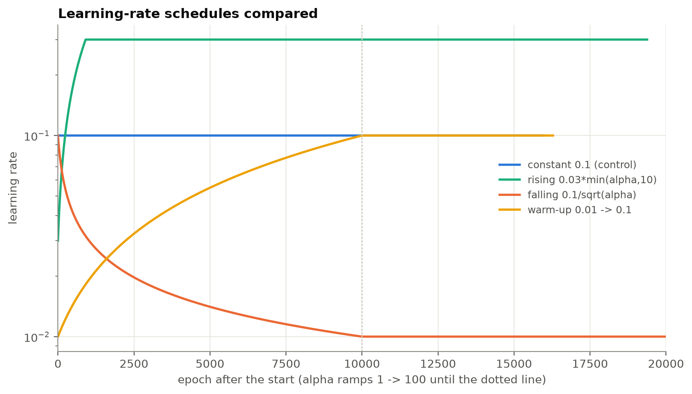
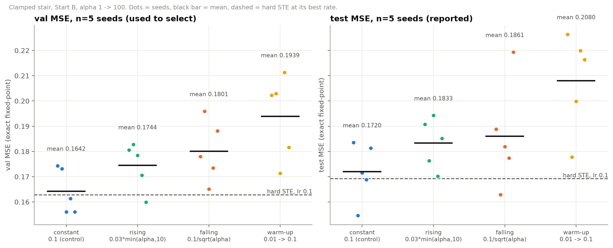
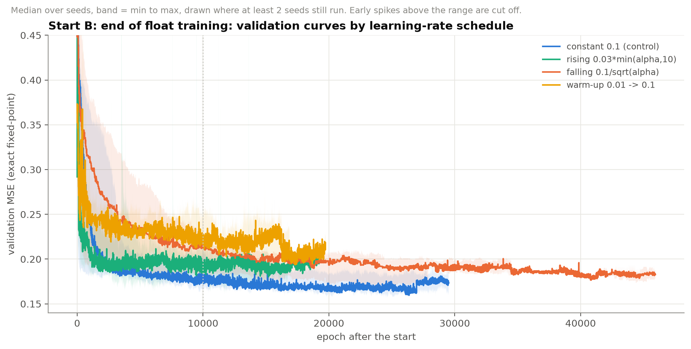

# E3c: alpha-dependent learning-rate schedules

Question: does tying the learning rate to alpha close the remaining gap between the clamped stair and hard STE?

## Setup

- Start B (end of float training), clamped slope, saturation mask on, beta = 1, 5 seeds (0 to 4).
- alpha ramps 1 -> 100 linearly over 10,000 epochs (100 was the best final alpha in E3b), then stays at 100.
- Full-batch SGD, patience 5000, min_delta 1e-6 on exact fixed-point validation MSE, checkpoint chosen only after epoch 9999, cap 50,000 epochs.
- Reference: hard STE at its best rate (lr 0.1, from E3a), test 0.1692 +- 0.0061.

| name | lr during training | idea |
|---|---|---|
| const (control) | 0.1 | no schedule; rerun at alpha_end = 100 so the comparison is like for like |
| rise (A) | 0.03 * min(alpha, 10) = 0.03 -> 0.3 | offsets the 1/alpha flat-zone slope; cap matches the clamped slope floor of 0.1 |
| fall (B) | 0.1 / sqrt(alpha) = 0.1 -> 0.01 | the old numpy rule |
| warmup (C) | 0.01 -> 0.1 over 10,000 epochs, then 0.1 | avoid the early spike near alpha = 1 |

## Results (exact fixed-point MSE, mean +- std over 5 seeds)

| schedule | val | test | test - hard STE (lr 0.1) | worse than hard STE | stopped epoch (median) | converged |
|---|---|---|---|---|---|---|
| constant 0.1 (control) | 0.1642 +- 0.0090 | 0.1720 +- 0.0116 | +0.0028 +- 0.0101 | 3/5 | 26963 | 5/5 |
| rising | 0.1744 +- 0.0093 | 0.1833 +- 0.0100 | +0.0141 +- 0.0084 | 5/5 | 16977 | 5/5 |
| falling | 0.1801 +- 0.0121 | 0.1861 +- 0.0209 | +0.0168 +- 0.0162 | 4/5 | 34491 | 4/5 |
| warm-up | 0.1939 +- 0.0167 | 0.2080 +- 0.0195 | +0.0388 +- 0.0198 | 5/5 | 16855 | 5/5 |

No run diverged. Hard STE at lr 0.1: val 0.1628 +- 0.0113, test 0.1692 +- 0.0061.

## What the data show

1. **Constant lr 0.1 is the best schedule, on validation and on test.** All three schedules are worse. By validation (the selection metric) the order is constant, rising, falling, warm-up.
2. **Constant 0.1 now ties with hard STE.** The test difference is +0.0028 +- 0.0101, with the clamped stair worse on 3 of 5 seeds. That is within seed noise, and it is the closest the stair has come. The paired difference was +0.0104 at lr 0.03 and alpha 100 in E3b.
3. **The falling schedule is the worst idea in principle, and it was not the worst here.** It shrinks the already-small flat-zone steps, and the curves show it descending slowest. Its mean test (0.1861) is dragged up by one seed at 0.219. One seed (3) reached the 50,000-epoch cap without converging, so its result may be pessimistic.
4. **The rising schedule is steady but not better.** It reaches 0.3 by about epoch 900 (alpha = 10) and stays there. It converges fastest, and it did not diverge even though constant lr 0.3 diverged 5/5 in E3a. It ends 0.011 test MSE behind the control.
5. **Warm-up is the worst, and the cause is likely partly the stopping rule.** It spends the first 10,000 epochs below lr 0.1, so at the point where checkpoints start being counted it is behind. Patience then ends it at about epoch 16,000 to 20,000, while its validation curve is still falling (the curve drops at about 16,000). The ranking here may partly measure how fast a schedule gets going, not how good its end point is.

## Caveats

- **The warm-up's purpose could not be tested.** Every constant-lr-0.1 run shows a transient spike in the first epochs (validation MSE 21 to 65 within 15 epochs, while alpha is still about 1). In E3a (final alpha 10) seed 1 never recovered from it and diverged. In this control (final alpha 100) all 5 seeds recovered. The two runs differ in final alpha and in ramp speed, and the spike happens before alpha has moved, so one seed does not show that a higher final alpha prevents divergence. Lr 0.1 is near the edge of stability.
- **Early stopping interacts with the schedule** (stopped epoch ranges from about 17k to 34k median). A matched fixed-budget comparison would remove this confound; it was not run.
- Each schedule has a single hyper-parameter setting (one lr0, one power, one warm-up length). A tuned rising schedule could do better. The fall/rise/warm-up forms are not an exhaustive search.
- Differences between 0.164 and 0.174 validation are comparable to the seed spread (about 0.009), so only the larger gaps (warm-up, and rising/falling against the control on test) are clear.
- The control is at alpha_end = 100 with 5 seeds; hard STE at lr 0.1 comes from E3a (alpha plays no role for it).

## Conclusion

An alpha-dependent learning-rate schedule does not help here. The constant rate of 0.1 is as good as hard STE within noise, and any schedule that lowers the rate during the alpha ramp (falling, warm-up) or raises it above 0.1 (rising) is worse. The earlier idea that high alpha needs a higher compensating lr is not supported: a fixed lr of 0.1 already gets the benefit.

Raw runs: `raw/` (gitignored). Rebuild the figures and table with `venv/bin/python -m experiments.torch_qat.report_e3c`.
